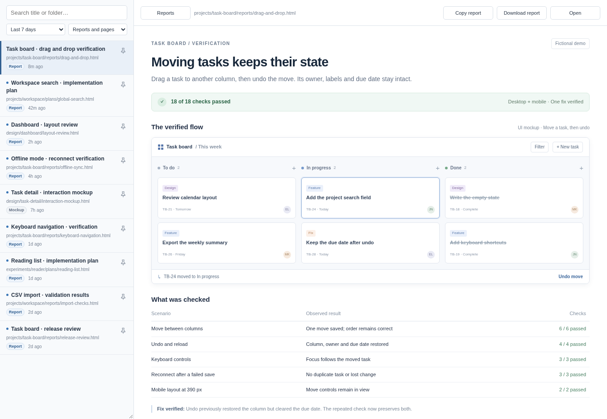

# HTML report viewer

As my coding agents, create visual build plans and verification reports as HTML files, use this report viewer to keep the scattered files all in one place.



## Start

Requires Python 3.11 or newer. The background service also needs Linux and systemd.

```sh
git clone https://github.com/StefMVP/html-report-viewer.git
cd html-report-viewer
./scripts/report-viewer-service start --root /path/to/reports
```

Open **http://localhost:8766**. The service stays active after the terminal closes.
Use `stop`, `restart`, `status` or `logs` in place of `start` to control it.

For foreground use without systemd, run `python3 -m report_viewer --root /path/to/reports`.
Run `python3 -m report_viewer --help` for other options.

Choose a root that contains only files you want the browser to read.
The viewer and separate report preview listen on localhost.

## Use

Search by title or path. Filter by type or age. Pin reports to keep them above
other results. Each group shows the newest reports first. Filters and the selected
report stay in the URL.

**Copy report** copies a local file link. **Download report** saves standalone HTML
with its styles, images, scripts, media and nested frames. **Open** opens the preview.
Links to internet sites in a report open in a new tab. Links to absolute file paths
inside the root open in the preview.
On mobile, use **Reports** to return to the list and **•••** for report actions.

Downloads preserve active HTML. Live APIs and asset URLs computed by scripts can
still need their original sources.

<details>
<summary>Mobile access</summary>

Use Tailscale Serve for private access. Save `remote-access.json` in the state
directory (default: `~/.local/state/report-viewer`):

```json
{
  "viewer_origin": "https://device.example:8445",
  "preview_origin": "https://device.example:8446",
  "trusted_user": "owner@example.com"
}
```

Use your device name and Tailscale login. Restart the service, then run:

```sh
tailscale serve --bg --https=8445 http://127.0.0.1:8766
tailscale serve --bg --https=8446 http://127.0.0.1:8768
```

The two origins must differ. The app checks the identity supplied by the private proxy.

</details>

## Development

Run `./scripts/check` with Python and Node.js. Run `./scripts/check-package` with
`uv` to check a clean package install. Browser checks and screenshot commands are
in `python3 tests/browser_fixture.py --help`.

## License

[MIT](LICENSE). The bundled [es-module-lexer](report_viewer/vendor/NOTICE) has its
own [MIT license](report_viewer/vendor/LICENSE).
